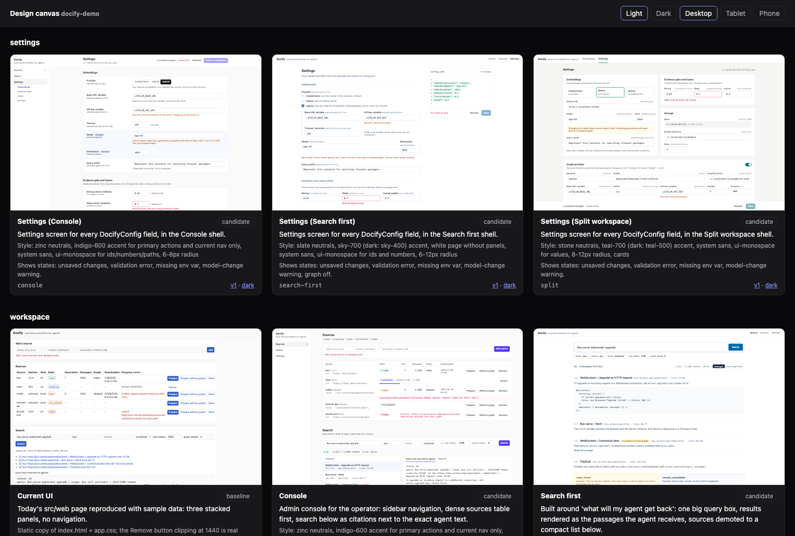
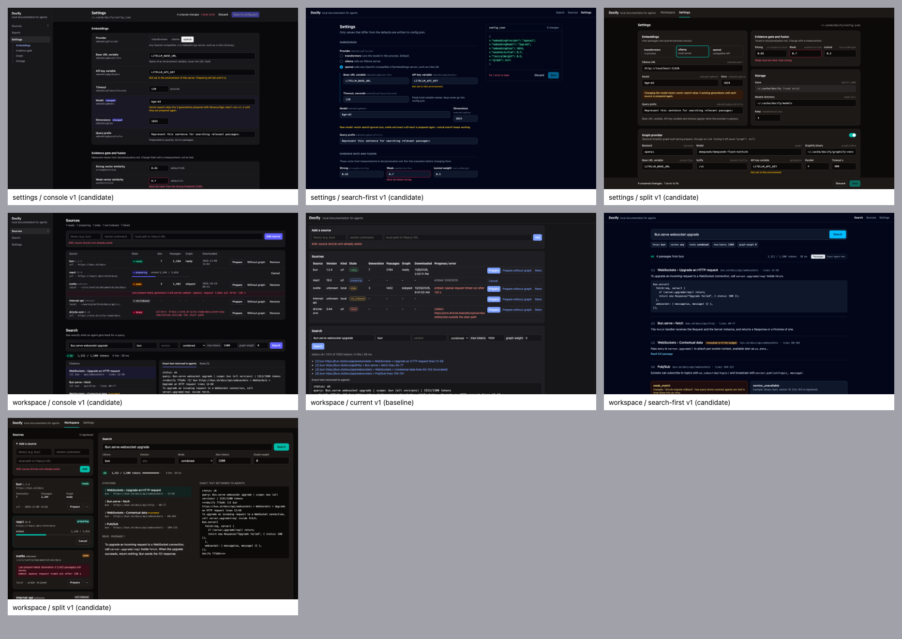

# design-studio

See your UI redesigned before anyone touches the code. Ask Claude Code for new directions for a screen, and compare them side by side as live previews on a local canvas.

No separate design tool and no design credits. The drafts are drawn by the model you already use, and the drafts and the canvas stay in your project.



## What you get

- **Today's screen as a baseline.** Claude rebuilds the current screen with sample data, so every idea is compared with what you have now.
- **Two or three real directions.** They differ in layout, navigation or density, and they use your labels, your data and every state it can be in.
- **Drafts that were checked.** Claude renders each one in light and dark mode and fixes what looks wrong before you see it.
- **One place to compare.** Every draft and every version on one canvas, in light and dark, at desktop, tablet and phone size.

Your product code changes only when you say "implement it".

## Install

You need Claude Code, [Bun](https://bun.sh) and Chrome (or Chromium, Edge or Brave).

```bash
claude plugin marketplace add kolezka/design-studio
claude plugin install design-studio@design-studio-local
```

Start a new Claude Code session, and you are ready.

## Try it

In any project, ask for a design:

> The settings page looks dated. Show me two directions before we change any code.

Claude looks at the screen's code, draws the drafts, checks them, and gives you a link to the canvas. Then keep talking:

1. **Compare** the directions on the canvas.
2. **Refine:** "go with the second one, but make the list denser". Claude adds a new version and keeps the old one.
3. **Pick:** the style of the chosen draft becomes the rule for every later screen.
4. **Build:** "implement it", and Claude turns the draft into code in your stack.

It works for new screens too: "design an onboarding screen in the same style as the dashboard".

## Review on the canvas

Each draft is a card with a live preview. Lines show which idea grew out of which, and each card keeps every version one click away.

To ask for a change to one part of a draft, open Full preview and click that element. The canvas writes a request you can paste into the chat.

For a quick overview, Claude can also lay all drafts out on one image:



## Good to know

- Everything is saved in `.design/` in your project. Commit it to keep the design history, or add it to `.gitignore`.
- Drafts are HTML. Turning the chosen one into your framework's components is the "implement it" step.
- Drafts load Tailwind from a CDN, so rendering needs an internet connection.
- Drafts can run scripts. Only open drafts from sources you trust.
- Draft quality depends on the model. It was tested with Claude Opus 5.5.

## More

- [User guide](docs/guide.md): the canvas in detail, the `.design/` folder, the `canvas` and `shot` commands, updating and removing the plugin
- [DeepSeek Harness](docs/deepseek-harness.md): using design-studio outside Claude Code
- [How it was tested](docs/testing.md): what went wrong without the skill, and what it fixes
- [Development](docs/development.md): source layout, tests and refreshing the screenshots

The screenshots show [Quayside](docs/demo/quayside), a fictional demo project. Not affiliated with Superdesign.

## License

Copyright (c) 2026 Mariusz Rakus. All rights reserved. See [LICENSE](LICENSE).
